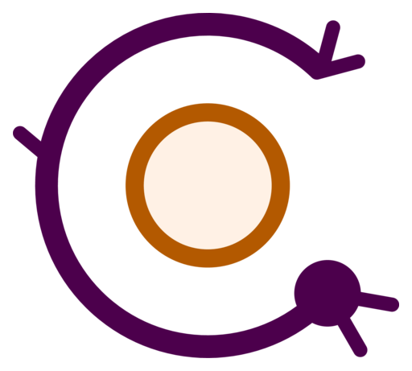
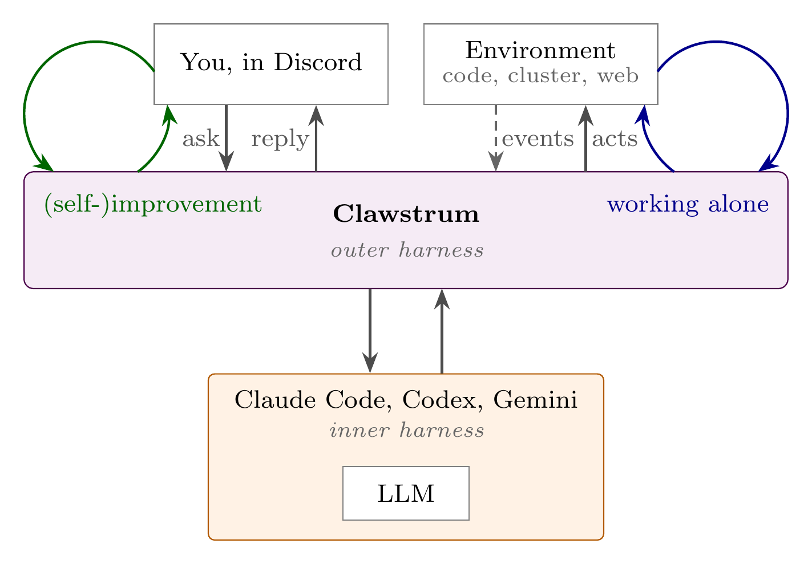

<p align="center">
  <picture>
    <source media="(prefers-color-scheme: dark)" srcset="docs/images/logo-dark.png">
    
  </picture>
</p>

<h1 align="center">Clawstrum</h1>

<p align="center">
  A personal and customizable research agent for computational science.
</p>

<p align="center">
  <a href="#install">Install</a> ·
  <a href="docs/index.md">Docs</a> ·
  <a href="docs/customize.md">Customizing</a> ·
  <a href="LICENSE">MIT license</a>
</p>

<p align="center">
  
</p>

Clawstrum runs Claude Code, Codex or Gemini as an agent you talk to in Discord, one channel per project. It drives them through their SDKs and the Agent Client Protocol (ACP). It runs on a machine you choose, such as a laptop, a server or a cluster login node, with full shell, file and network access. It messages you when a job ends, keeps each project's memory in plain files, and changes its own instructions and code when you tell it what went wrong.

## Install

You need Linux or macOS, and Claude Code, Codex or Antigravity CLI (Gemini) to run the setup. The agent itself runs on a Claude, ChatGPT or Google subscription.

```sh
git clone https://github.com/clawstrum/clawstrum.git
cd clawstrum
claude        # or: codex, or agy
```

In Claude Code, type `/setup`. In Codex or Antigravity CLI, say "help me install Clawstrum". The agent asks where Clawstrum will run, installs it, takes you through creating a Discord bot, signs in to your subscription and starts the service. On a cluster it runs in tmux on the login node and sends heavy work to jobs.

To install without an agent, see [setup](docs/setup.md).

## First conversation

Open the `main` channel. The agent writes first and asks about your field, your projects and how you like answers. Each project gets its own channel. It also offers voice notes and a few optional keys, and saves nothing until you agree. Later, `main` is where you tell the agent what to change about itself.

## Features

[Architecture](docs/architecture.md) has a figure of every part a message passes through.

- Each Discord channel has its own conversation, files and memory. By default only the owners you configure can give it work.
- Before each run, a router picks the skill for the message. Skills are files that hold recurring procedures.
- The agent you talk to runs on Clawstrum's own prompt instead of the coding agent's default, followed by your `AGENTS.md` instructions. Subagents keep the default. Gemini's prompt can't be replaced, so there Clawstrum's prompt is added to it.
- Memory is plain `AGENTS.md` files, from one shared by all channels down to one per channel. Every message and tool result stays searchable. Once a day a background pass updates each channel's memory from the new conversation and cites the records behind each change. See [memory](docs/memory-lifecycle.md).
- Hooks check each tool call before it runs. Side work goes to subagents with fixed roles, such as explorer, coder, checker and reviewer.
- The agent can watch a file, a command or a Slurm job, or schedule a run. Clawstrum waits without calling the model and wakes the agent when something changes. An optional mode keeps it working toward a goal while you are away.
- A message you send while the agent works joins the current run on Claude and Codex. On Gemini it ends the current turn and starts a new one with the same context. A message with a file attached always waits. See [live steering](docs/live-steering.md).
- Research tools: literature search, paper retrieval with citation checks, Slurm jobs, and channel groups that share findings between related projects.
- Work can spread over several subscription accounts. When one reaches its limit, work moves to another.

## Changing it

Tell the agent in any channel what went wrong or what you want. It edits its instructions, skills, settings or code, starting with the smallest change that does the job. Code changes go through `clawstrum apply`, which type-checks, builds and tests a copy before Clawstrum restarts on it. A nightly review in `main` looks for what went wrong, makes small fixes within the scope you allow and checks later whether they helped. See [customizing](docs/customize.md).

Keep your changes in your own copy, and send the ones that would help others as a pull request.

## Security

Every message the agent accepts runs with full access to the machine.

- Run Clawstrum as its own user, on a server or cluster account set aside for it.
- Text the agent reads, such as a web page or another bot's message, can carry instructions that it may follow.
- A hook blocks common commands that print a secret file such as `.env` or the whole environment. It only catches known patterns, and it is off when `research.enabled` is false. See [secret files](docs/hooks-and-gates.md#secret-files).
- `send_file` refuses Clawstrum's keys, logins, history and database, home dotfiles and secret files such as `.env`, on every provider. A copy under another name still goes out.

## Commands

In Discord, use `/clawstrum` or the text form.

```text
!clawstrum status
!clawstrum accounts
!clawstrum switch backup
!clawstrum stop
!clawstrum resume
!clawstrum reset
```

`switch` stops the current work and continues it on another account. `stop` cancels running and queued work. `resume` retries what failed or was delayed. `reset` starts a fresh session and keeps files and history. On the server, `clawstrum --help` lists every command.

## Documentation

| To                     | Read                                                                  |
| ---------------------- | --------------------------------------------------------------------- |
| Install or reinstall   | [Setup](docs/setup.md)                                                |
| Change settings        | [Configuration](docs/configuration.md) · [CLI](docs/cli.md)           |
| Change the agent       | [Customizing](docs/customize.md)                                      |
| Understand memory      | [Memory](docs/memory-lifecycle.md)                                    |
| Use the research tools | [Research tools](docs/research.md) · [Channel groups](docs/groups.md) |
| Run and debug          | [Operations](docs/operations.md) · [Testing](docs/testing.md)         |
| Find anything else     | [All docs](docs/index.md)                                             |

## Authors

Jorin Overwiening and Xu Pan

## License

Clawstrum's code is MIT licensed. Provider SDKs keep their own licenses and service terms. Clawstrum descends from NanoClaw, see [NOTICE](NOTICE).
