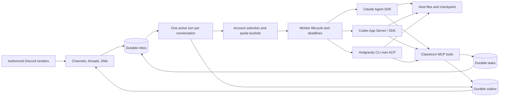

# Clawstrum architecture

Clawstrum is a single-host Node.js service. SQLite owns work and output; Discord owns communication; the Claude and Codex SDKs and Gemini's Antigravity CLI run in supervised child processes with unrestricted host access. Process separation provides lifecycle control, not a sandbox. Claude also answers SDK `canUseTool` escalations explicitly with the configured full-access approval, without rewriting arguments or storing permanent permission rules. Cancellation still wins. Approval diagnostics retain the tool and outcome, not raw arguments or free-form reasons.

## Ownership and execution

SQLite defaults to WAL, synchronous FULL, foreign keys and short transactions. An optional host-pinned `STORAGE.json` controls database/mutex placement and WAL versus DELETE journaling; see [storage operations](operations.md#state-and-session-storage). Put live state on local disk. A separate SQLite exclusive mutex owns the daemon lifetime; atomic PID/host metadata supports diagnostics and compatibility with older daemons. The mutex file is never unlinked to steal a stale lock.

A claim creates a stable logical input batch. A ready Claude or Codex user run can explicitly add newly arrived text after an IPC acknowledgment; normal retry claims cannot absorb later messages. Gemini runs take no live input; new text waits for the next turn. Each conversation has one active turn, with global and per-account concurrency limits. Debounce observes user typing but has a ceiling. Live steering respects ordered retry/attachment barriers, and accepted input joins the same durable run for handoff and recovery. See [live-steering.md](live-steering.md). Transient failure counts are per input; abrupt daemon interruptions have a separate counter. Account changes, capacity waits and graceful shutdown do not consume transient retries.

Controls run independently of the model. Stop only affects input at or before its timestamp. Switching retains unfinished input and selects another profile with a portable handoff. Files and already-started external actions are not rolled back.

Default deadlines are 120 seconds for startup, ten minutes of event silence and two hours for the whole turn. An observed in-flight tool or live Claude background task suspends only the silence deadline; completion restarts silence timing, while the absolute turn deadline still bounds the wait. Silence/absolute deadlines can be explicitly disabled. Cancellation asks the subagent to abort, then escalates to TERM/KILL with bounded reaping. Diagnostic writes are best effort and cannot block abort. Completed partial text and stderr are retained; interruption snapshots include timing, recent events, resource usage and Linux process attribution. Deliberately detached jobs remain separately owned.

Newly admitted live human requests are persisted with an anchor for useful operational notices, without an automatic queue message. Selected waiting/retry notices create or reuse a real Discord thread on that message only when needed; model-written acknowledgments and answers remain in the conversation. The outbox freezes each notice's message anchor, fallback policy and resolved Discord destination in schema-3 metadata. Ordering is per conversation and notice anchor, so a thread retry cannot hold up the main reply queue. Thread creation recovers using the starter-message ID, including after a lost response. The default AGENTS.md asks the agent to send one short message saying what it will do next before it starts; a custom AGENTS.md can drop that rule. A final answer followed by a held-open Claude background wait can accept new text at a native result boundary; its fresh reply scope prevents previous output from masking the new answer. See [live steering](live-steering.md) and [Discord notice behavior](setup.md#discord).

Long Discord replies are split into ordered messages. The outbox stores a frozen chunk plan and acknowledged message IDs in metadata; retries resume at the first unacknowledged part. Stable per-part nonces cover recent ambiguous sends, with the same finite deduplication limit as single-message delivery. Explicit files accompany the last part.

## Continuity and accounts

Selection honors an explicit requested profile. Otherwise it tries higher account `priority` first (default `0`), then model tiers and observed quota headroom within that priority, retaining the active profile on close ties. Availability and concurrency always apply. Authentication disable and quota cooldown are independent. Quota buckets retain their own observations; unmapped weekly warnings softly prefer another account, mapped model warnings prefer an unaffected route, hard model limits select another configured model, shared rejections block all models, and a shorter reset cannot overwrite a longer block. Unknown reset times use a disclosed 15-minute fallback. Account reset wakes deferred input. Soft pressure never blocks the last available route and expires at its reset or the unknown-reset fallback. Configured `discord.noticeChannelId` receives warnings even before user input creates a conversation there.

Each profile has a distinct canonical provider home. Native resume requires the same account and compatible execution configuration. File-backed instructions and memory refresh independently, preserving native history. Clawstrum explicitly loads shared/workspace AGENTS.md and its imports for all three providers; legacy SELF.md and CLAUDE.md are fallbacks. Claude disables system-prompt snapshots and refreshes active context at input/tool boundaries; Codex acknowledges developer-message updates with thread/inject_items. Gemini (ACP has no system field) gets the base prompt and instructions at the start of its first prompt, and changed instructions at the start of the next prompt. See [instruction discovery and refresh](instructions.md). When a native session is replaced, the agent receives current shared/channel AGENTS.md MEMORY, a bounded uncovered continuation, archive access and pending input.

`artifacts/skills-index.txt` contains the full inventory. Large descriptions point to that file without silently dropping skills. A skill may also declare `triggers:` in its frontmatter, a short list of literal phrases; when one appears in what was just said, the prompt names that skill and the phrase that matched. Matching is word-boundary literal against the declared list only, never against description prose, and at most three skills are named. The hint is appended to the turn prompt rather than to the instructions, which have their own refresh revision. It reports that a skill looks applicable and does not require it. When Jev has not decided, the top match's SKILL.md body is loaded into the turn under a header saying it came from a keyword match and can be wrong; the other matches stay as pointers. If that file cannot be read, or on the retry after a context overflow (where the body would push the current input out of the 16,000-character budget), all matches are pointers.

`CONVERSATION.json` records outstanding input and recent delivery status. Host context has a total character budget with complete overflow files; raw history is independently archived and paginated. There is no per-memory-file fitting or stale-file consolidation reminder. An idle dedicated subagent reconciles the full unprocessed history interval into AGENTS.md MEMORY: once a local day for each channel with new history (no rotation), and after a native compaction (with rotation). A byte threshold is available but off by default. Native compaction has one preservation/restoration hook and no extra model call. See [memory lifecycle](memory-lifecycle.md) for commits, recovery and migration. Hidden provider state is not portable.

## Delivery and scheduling

Output insertion or payload-checked deduplication and final ownership are one transaction. Explicit finals preserve distinct caller keys within logical input scope; automatic final output uses a canonical key. A reused key with different content is an error. Outgoing files use private immutable copies; duplicate copies are discarded. Discord delivery uses stable nonces and retries independently of model execution, until Discord rejects the request or a day has passed.

Incoming downloads enforce metadata and streamed size limits, share cancellation, refresh expired CDN metadata when possible and retry per input. A bad attachment does not fail neighboring requests.

Each scheduled occurrence and its next cursor commit together, with a separate transaction per task. Invalid schedules fail visibly without stopping healthy tasks. One-shots and timezone-aware cron are supported; cron allows at most one wake per minute and one queued/running occurrence per task; human requests take priority over queued tasks. Keys are idempotent within a logical input and reusable in later inputs. Lists return one latest occurrence; CLI history and exports expose the underlying runs. Meaningful scheduled return text has automatic delivery fallback; `CLAWSTRUM_QUIET` explicitly suppresses routine notifications.

The MCP helper uses a persisted run configuration snapshot and rejects stale-run tool calls. Editing configuration midway through a run cannot independently change the helper's limits or disable it.

## Recovery and limits

Discord history recovery runs on startup, reconnect and periodic sweeps. It discovers configured channels, owner DMs, active and recent accessible archived threads, with a 1,000-message bound per channel. Deleted, inaccessible or older history is not guaranteed recoverable.

Doctor reports daemon heartbeat, queue/run ages, schedule failures, failed deliveries and file permissions alongside installation/auth checks. Offline backup snapshots harness-owned state and SQLite; online snapshots cover SQLite alone, with integrity checks and optional retention. Coordinated restart drains active work before a supervised replacement; deterministic condition watches and optional self-review use existing durable metadata. See [workflows](workflows.md). Transfer/diagnostic/transcript cleanup previews before optional application and preserves pending/failed files. Database history is retained.

The core intentionally keeps Discord-only communication and full host autonomy. It adds no permission gate, mandatory skill policy, automatic cross-conversation memory extraction, or background self-modification. The default-on research profile supplies delegation guidance; explicit strict validation redirects native subagent and workflow dispatch to the existing bounded `research_delegate` path. Naming a native subagent after a role does not apply that role’s model or resource limits. External side effects, arbitrary detached jobs and Discord sends cannot share an exactly-once transaction with SQLite. Live bot/account acceptance remains separate from controlled local tests.

Transient failures receive fast retries followed by persistent five-minute retries by default; fatal errors and repeated abrupt interruptions remain bounded. Native sessions rotate after consolidation once a conversation's unconsolidated raw history reaches `runtime.consolidation.thresholdBytes`. Each subagent records its executable version and honors an explicit quarantine. Configuration details are in the [configuration reference](configuration.md).

## Research profile

The daemon owns a research subagent manager and deterministic Slurm monitor alongside the main turn queue. Subagents have separate supervised process groups, fresh provider contexts and durable artifact/results; completion enqueues a parent task for synthesis. Shared account capacity includes both kinds of model work. Slurm submission records intent before the external call and reconciles ambiguous outcomes without replay. Citation metadata and research notes are separate SQLite records. Claude hooks provide optional validation, compaction archiving and background-input hold; hooks run on Claude only, and the shared tools work with all three providers. See [research.md](research.md) for the complete state machines and limitations. Schema 3 adds four research tables and explicit outbox provenance.

## Channel groups (schema 5)

Related Discord channels can share G/AGENTS.md policy and a SQLite-backed current information board under `H/groups/<id>/`. Publications refresh member context immediately at existing provider boundaries without rotating sessions. An economical subscription reviewer reconciles complete board/change inputs, preserves raw history, and sends concrete issues to Discord review threads. Membership, multiple audiences, revisions, recovery and upgrade requirements are described in [channel groups](groups.md). Existing H/W memory and channel workspaces retain their roles.
