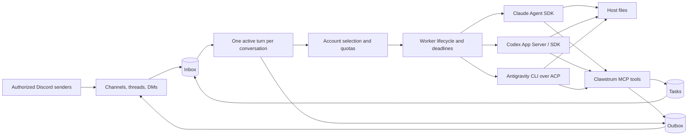

# Clawstrum architecture

Clawstrum is one Node.js service on one host. SQLite holds work and output, and Discord carries all communication. Claude Code (Agent SDK), Codex (App Server or SDK) and Gemini (Antigravity CLI over ACP) run in supervised child processes with full host access. The separate processes give lifecycle control. They are not a sandbox.

## Storage

SQLite runs in WAL mode with synchronous FULL. A host-pinned `STORAGE.json` can move the database and its lock, or switch to DELETE journaling ([storage](operations.md#state)). Keep live state on local disk. A separate SQLite lock owns the daemon's lifetime, and Clawstrum never deletes the lock file to take over a stale lock.

## Turns

- Each conversation has one active turn. `runtime.maxConcurrent` (default 4) limits turns overall, and an account's `maxConcurrent` limits turns per account.
- Clawstrum waits while you type, up to a ceiling, before it starts a turn.
- On Claude and Codex, text you send during a run joins it. On Gemini it waits for the next turn. A message with a file waits too. See [live steering](live-steering.md).
- Stop affects only input sent up to that moment. Switch keeps unfinished input and hands it to another account. Neither rolls back files or actions already started.
- Claude's tool approval requests are answered with the configured full-access approval. Arguments are not changed and no permanent rules are stored.

Default deadlines are 120 seconds to start (`runtime.startupTimeoutMs`), ten minutes without events (`runtime.silenceTimeoutMs`) and two hours per turn (`runtime.turnTimeoutMs`). 0 turns off the last two. A running tool or Claude background task pauses only the silence deadline. Cancelling asks the process to stop, then sends TERM and KILL. Partial output is kept, and detached jobs keep running.

## Accounts

Clawstrum uses the account you asked for if there is one. Otherwise it tries accounts with higher `priority` first (default 0), then picks by model tier and remaining quota, and keeps the current account when the difference is small.

- A failed sign-in and a quota cooldown are tracked separately.
- A weekly quota warning prefers another account. A model limit moves to another configured model. A limit on the whole account blocks all its models.
- An unknown reset time counts as 15 minutes (`runtime.unknownQuotaCooldownMs`). When an account resets, waiting input runs.
- Soft limits never block the last available account.
- `discord.noticeChannelId` receives quota warnings, even before anyone has written in that channel.

Each account has its own provider home. A native session resumes only on the same account with compatible settings. When a session is replaced, the agent gets current memory, recent uncovered history, access to the archive and pending input. See [memory](memory-lifecycle.md) and [subscriptions](subscriptions.md).

## Delivery

- Output is saved and deduplicated in one transaction. Messages with the same key are sent once. Reusing a key with different content is an error.
- Outgoing files are sent from private copies.
- Discord sends retry on their own, until Discord rejects them or a day has passed.
- Long replies are split into ordered messages. A retry resumes at the first unsent part, and attached files go with the last part.
- Waiting and retry notices go into a thread on your message, created only when needed. The agent's replies stay in the channel. See [setup](setup.md#notices).
- Incoming attachments are size-checked and retried per message. A bad attachment doesn't fail the messages around it.

## Scheduling

- Tasks are one-shot or cron with a time zone. Cron runs at most once a minute, with at most one queued or running occurrence per task.
- Your messages go before queued tasks.
- An invalid schedule fails visibly and doesn't stop other tasks.
- A scheduled run's text reply is delivered unless it returns `CLAWSTRUM_QUIET`.
- Each run's tools use the configuration the run started with. Editing the configuration mid-run doesn't change them.

See [workflows](workflows.md) for watches, [operations](operations.md#planned-restart) for restarts and [customizing](customize.md#self-review) for self-review.

## Recovery

- Discord history is caught up on startup, on reconnect and periodically. It covers configured channels, owner DMs, and active and recently archived threads, at most 1,000 messages per channel. Older or deleted messages may be lost.
- Transient failures get fast retries, then a retry every five minutes by default (`runtime.slowRetryMs`). Fatal errors and repeated crashes stop after a limit. Account switches, quota waits and shutdowns don't count as failures.
- `clawstrum doctor` reports the daemon heartbeat, queue and run ages, failed schedules and deliveries, and file permissions.
- `clawstrum backup DIRECTORY` snapshots state. `clawstrum gc --before DATE` previews file cleanup, and `--apply` runs it. Pending and failed files are kept. See [operations](operations.md).
- Each run records the provider's executable version, and a quarantined version won't run.

## Limits

- Discord is the only channel, and the agent has full access to the host. There is no permission gate, and skills are never forced on the agent.
- External actions, detached jobs and Discord sends can't share a transaction with SQLite, so they are not exactly-once.
- Naming a native subagent after a research role doesn't apply that role's model or limits. On Claude, with roles configured and `research.workers.enforceRoles` at its default `deny`, native subagent requests are refused and sent to `research_delegate`. See [subagent routing](hooks-and-gates.md#subagent-routing).
- Hidden provider state doesn't move between accounts.

All settings are in the [configuration reference](configuration.md).

## Research

The daemon also runs research subagents and a Slurm monitor next to the main queue, sharing account capacity. Clawstrum's tools, the research tools included, work on all three providers. Hooks run on Claude only. See [research](research.md).

## Channel groups

Related channels can share instructions and a board of current findings under `H/groups/<id>/`. See [channel groups](groups.md).
