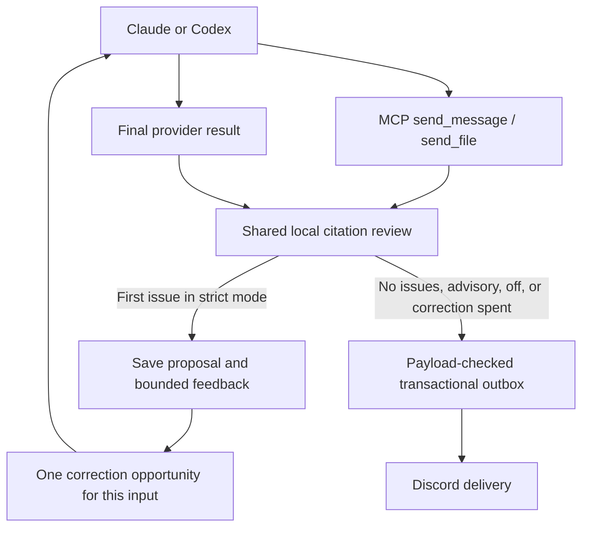

# Hooks and gates

Clawstrum checks citation attribution in what the agent writes and reviews each outgoing reply once before delivery. Every conversation keeps the same full host access. Validation is advisory by default: findings are recorded and returned to the agent, and nothing is refused unless you set `research.validation` to `strict`. This page explains these choices and how the checks work.

## Design choices

| Question                                                  | Choice                                                                      | Reason and implementation                                                                                                                                                                                                                                                                                                                                                                                                                                                                                                                                                                               |
| --------------------------------------------------------- | --------------------------------------------------------------------------- | ------------------------------------------------------------------------------------------------------------------------------------------------------------------------------------------------------------------------------------------------------------------------------------------------------------------------------------------------------------------------------------------------------------------------------------------------------------------------------------------------------------------------------------------------------------------------------------------------------- |
| 1. Should validation be strict by default?                | No: `advisory` is the default and `strict` is explicit                      | Enabling research tools is not consent to new denials, especially for existing installations. Routing is the exception: `workers.enforceRoles` denies native dispatch by default while content validation stays advisory, because redirecting a call to a configured equivalent is not the same kind of denial as refusing what a call wrote, and it takes no capability away from the lead.                                                                                                                                                                                                            |
| 2. Should writes be confined to a workspace?              | A validation check that states it is not confinement                        | A predicate on Write/Edit/NotebookEdit leaves shell writes, symlinks and other full-access programs available; resolving a path against a workspace is path interpretation, not confinement. The check exists because it catches a mistake rather than an attack: an agent writing a report or a memory file to a path it half-remembers from another conversation. Its denial reason says the write is out of scope and names `research.writeRoots`; it claims no isolation, and the [research](research.md) validation section states that none of these checks confines another full-access program. |
| 3. Should citations be checked against their attribution? | Yes, with conservative association and explicit limits                      | `research/citations.ts` checks author–year pairs and plain BibTeX fields against saved registry metadata, including references whose identifiers already resolve. Claude write previews and a shared explicit scan tool use it.                                                                                                                                                                                                                                                                                                                                                                         |
| 4. Should outgoing replies be reviewed?                   | Yes, at Clawstrum's outgoing boundary                                       | `research/replies.ts` runs before new outbox insertions from MCP sends and automatic provider results. It works with both providers and permits one corrective reply attempt in strict mode. The same review measures the message body against configurable line and character ceilings and shares that single attempt with the citation findings, since one reply that is both long and wrong is one reply to fix. No provider-specific Stop hook is needed for this host-owned boundary.                                                                                                              |
| 5. Should important procedures be gated?                  | Executable job checks and citation checks; no general skill-invocation gate | `research_cluster submit` runs preflight on the captured script and starts a durable watch after a recognized submission. This checks actual operation state. A catalogue remains useful for optional procedures; reading it is not mechanically guaranteed.                                                                                                                                                                                                                                                                                                                                            |
| 6. Should one channel have more rights than the others?   | No: host access is uniform                                                  | A dedicated maintenance workspace can carry its own instructions, memory and skills without a permission hierarchy. Changes to shared code can affect every workspace even when made from a designated maintenance channel.                                                                                                                                                                                                                                                                                                                                                                             |

A hook that only refuses the first `sbatch` and lets later submissions through does not check whether preflight ran. Clawstrum's structured submission helper instead runs its checks on the captured script. Full-access raw commands can still bypass that helper.

Clawstrum owns both delivery paths, so native final text is reviewable after the SDK returns and before the host enqueues it. The automated review checks citation metadata and length. It does not claim to detect unexplained jargon or to enforce writing quality; concise, context-complete writing remains an instruction.

## Citation implementation

`citationOccurrences()` preserves offsets and repeated occurrences; `citationRefs()` retains its deduplicated interface for existing retrieval callers. DOI parentheses and requested arXiv versions are preserved. Scanning uses saved Crossref/DataCite/arXiv records without a network request or model call. Missing records remain unresolved; no fabricated metadata or user-supplied “verified” flag is introduced.

The prose parser recognizes explicit forms such as `Doe (2024)`, `Doe et al. (2024)`, `(Doe, 2024)`, `Doe & Smith (2024)` and `Doe, J. (2024)`. Each author–year pair is associated with a nearby following identifier in the same line/semicolon-delimited unit, within 240 characters, before another attribution. A preceding identifier is accepted only for a sole pair. Multiple competing identifiers remain ambiguous. Surname comparison normalizes accents and common spelling variants and does not accept a matching given name as a surname. Each named author must match; the year allows a one-year metadata difference. Repeated appearances of the same identifier are checked separately.

BibTeX scanning reads balanced entries and nested braced/quoted fields. With one distinct identifier in an entry, plain author surnames, title and year fields are checked. BibTeX surnames use the first comma-delimited component, or the final word for an uncommaed name; given-name abbreviations are not treated as contradictions. This does not verify given-name expansions or every surname convention; use explicit structured checks and source review for those claims. arXiv `eprint` with `archivePrefix=arXiv` or `eprinttype=arXiv` is recognized. Entries containing different DOI/arXiv identifiers are treated as ambiguous because the scanner does not establish version equivalence. TeX-encoded fields are skipped rather than partially decoded and declared wrong.

Fenced examples/logs are excluded. Recognized document extensions are `.md`, `.markdown`, `.tex`, `.bib` and `.rst`; `.txt` logs are not automatically treated as manuscripts. Explicit scans accept any text or file. The limit is 2,000,000 bytes; larger documents need relevant excerpts. A scan returns `findings` with identifiers, line numbers and registry metadata, plus counts of identifiers, checked attributions and ambiguous associations. `ok` means no detected discrepancy, not that all citations or scientific claims were validated. Unrecognized syntax, line-spanning references, malformed BibTeX, ambiguous pairings, metadata gaps, quotations and retraction interpretation still require review.

Claude Write checks the proposed full content. Edit previews the actual substitution in the current file, so changing only a year beside an unchanged DOI can be detected. Invalid/non-unique replacements remain the native tool's error to report. Findings already present before an Edit are excluded from that edit's feedback, avoiding an unrelated legacy backfill; use an explicit whole-document scan for that review. These hooks do not intercept shell-based file generation or Codex's native edits. Both providers can call `research_citation` with `action=scan` and exactly one of `text` or `path` through MCP or the research CLI.

## Delivery, correction budgets and recovery

`send_message` checks text. `send_file` checks its caption and, for the prose extensions above, the immutable attachment copy. A held file creates no outbox row or final flag, and its temporary spool is removed. Automatic provider results are checked only when they would produce a new reply; an already-sent final, an identical queued result, and explicit quiet scheduled results retain their existing behavior. Idempotency keys still reject different payloads, and repeated successful tool calls do not spend another review opportunity.

With advisory validation, findings are recorded and delivery proceeds; MCP callers receive the review feedback with their queue result. In strict mode, the first problematic outgoing proposal is held. MCP returns an actionable tool error; an automatic result receives one additional provider call with bounded feedback and the saved proposal's path. The prompt explicitly requests correction of the answer and cautions against replaying completed external actions.

The outgoing budget is stored in the existing SQLite `metadata` table under the logical input ID. All parts, sends, final results, process restarts, durable retries and account/provider changes share it. A later proposal with remaining findings is allowed and recorded as such, so the checker cannot create an unbounded correction loop. This is a bounded quality intervention, not guaranteed rejection of every incorrect answer. A corrected proposal can still fail for ordinary provider or transport reasons; the existing recovery and cancellation rules apply.

Claude citation-write feedback separately permits one strict refusal per run and native agent, persisted across hook reconstruction. Further citation findings are advisory. In explicit strict mode, PDF/contact/raw-submission checks keep their existing denial behavior. All checks remain advisory with the default configuration. The hook records full findings in `research_validation` events while bounding model feedback. Subagent hook budgets do not consume the lead's budget. Daemon-owned research subagent returns are evidence for the lead, not direct Discord replies.

The same write hook runs the prose and figure linters on the payload it already holds, and their findings can never deny a write or spend the one strict correction, in any validation mode. Prose findings require a `.tex`, `.sty` or `.cls` target and an installation that keeps a writing-rules file, matching the manuscript gate's scope; figure findings require a `.py` target and recognize plotting syntax, including font configuration. These are heuristics, so configuration-only files can receive advice too. An Edit is previewed and its findings reduced to what the edit introduces, matched by code and message rather than by line, so touching an old manuscript does not report its backlog. Write content, existing Edit input files and complete Edit previews are limited to two million bytes/characters as applicable; larger payloads are skipped without running the linters. The observations are appended after the enforceable findings, so bounding model feedback to ten issues drops them first, and the `research_validation` event carries their count separately from the issue list.

Outgoing findings create `research_reply_review` events and private JSON files under `CLAWSTRUM_HOME/research/reply-reviews/<session>/`. Files retain the proposal, scan result, route, mode and whether delivery was held; SQLite holds the correction feedback. These artifacts join ordinary backups. Existing garbage collection does not remove research evidence automatically. No schema migration or config-version change is required for this addition.

## Context and subagent recommendations

Keep narrow subagent briefs, exact source paths/line ranges, artifact-backed bulk output and lead verification of cited evidence. The research prompt now states these explicitly, and a finished subagent result is additionally compared against that subagent's own event log before the lead is woken: no tool events at all, none of the supplied paths literally present in the recorded events, or cited absolute paths that do not exist. Those ride the wake message as caveats and never withhold a result. Role model overrides, two-subagent default concurrency, time/tool budgets, context metrics, transcript-byte rotation, early research notes and compaction archives were already implemented and remain appropriate.

A subagent read-only tool allowlist does not itself stop an unrestricted lead from reading files or doing its own analysis. No undocumented auto-compaction environment variable or assumed token threshold is installed globally. Existing supported SDK hooks restore state through SessionStart after compaction; durable files remain the portable handoff mechanism.

## Verification and remaining work

`test/hooks-review.test.ts` exercises local attribution association, repeated identifiers, Unicode surnames, BibTeX, missing records, fenced examples, Edit previews, scan input/size errors, persisted budgets, both provider result paths, account switching and real MCP delivery/attachment idempotency.

These tests use fixtures, not a live bot, an authenticated model or a cluster job. A useful empirical evaluation should measure false refusals, corrected versus unchanged outputs, ambiguous/unrecognized references, additional model work and user-visible delivery success using matched examples. The source and fixture evidence support the implemented mechanism; they do not establish a production accuracy rate.

## Other checks and choices

| Topic                                                | Behavior                                                                                                                                                                                                                                                                                                                                                                                                                                                                                                                                                                                                                                                                                                                                                  |
| ---------------------------------------------------- | --------------------------------------------------------------------------------------------------------------------------------------------------------------------------------------------------------------------------------------------------------------------------------------------------------------------------------------------------------------------------------------------------------------------------------------------------------------------------------------------------------------------------------------------------------------------------------------------------------------------------------------------------------------------------------------------------------------------------------------------------------- |
| Subagent dispatch routing                            | Native Task/Agent and Workflow dispatch is redirected to `research_delegate` even when a native role name matches, since only the shared manager applies the configured model, effort and resource budgets. Severity is set by `workers.enforceRoles`, not `validation`, and it denies by default, because a routing finding offers nothing to revise and the redirect target is available in the same turn. Where no roles are configured this check does not fire, and it removes nothing from the lead's own tools.                                                                                                                                                                                                                                    |
| Notes file growth                                    | An advisory-by-default budget check on Write/Edit and recognized shell writes; explicit strict mode can deny them. It compares the projected size against the same budget the prompt assembly reads, allows any write that leaves an oversized file smaller, and its shell branch states that Write and Edit remain available so it cannot block its own remedy. Clawstrum still promises a bounded rendered excerpt rather than a fixed-size source notebook.                                                                                                                                                                                                                                                                                            |
| Compaction context                                   | Pre/PostCompact `systemMessage` does not reach model context, so scoped state dumps and post-compaction guidance use the supported SessionStart context path. Concurrent lead/subagent/native-agent snapshots have separate ownership.                                                                                                                                                                                                                                                                                                                                                                                                                                                                                                                    |
| Session-end extraction                               | No model call runs at session end. Complete-interval consolidation before planned rotation does that work. A Clawstrum session is a durable row that never closes, so there is no session-end boundary to hook; staleness stands in for it.                                                                                                                                                                                                                                                                                                                                                                                                                                                                                                               |
| Writing rules                                        | Explicit strict mode requests a successful writing-rules read before substantial LaTeX writes where rules exist, with at most three findings per native context between compactions. Advisory mode reports the finding and proceeds. The rules' content remains guidance: the gate decides whether they were read, not whether the prose follows them. Three of them are measured separately by the prose linter, which the same hook now runs on every manuscript write and whose findings never deny.                                                                                                                                                                                                                                                   |
| Paper push without a reviewer                        | `workers.review.paperPush`, `off` by default, independent of `validation`: a PreToolUse check on Claude leads' `git push` against the upstream merge-base, working tree included, triggering on a caption, section heading, figure or `\includegraphics` line, abstract text, a number, an image, or 800+ changed characters (untracked files only if a tracked `.tex` uses them or the push `git add`s them). It needs a checker or reviewer result after the first `.tex` edit; later edits re-arm it only if they trip a trigger alone, a retry needs an unchanged tree, state is per git toplevel. `deny` refuses at most three times per change, `advise` adds context. What git cannot answer is allowed and recorded (`research_paper_push_gate`). |
| Direct PDF and anonymous literature-service requests | Host extraction and configurable contact identification. The retrieval helper adds Crossref contact metadata when configured and requires an email for its Unpaywall route. There is no OpenAlex route and no universal denial of anonymous requests.                                                                                                                                                                                                                                                                                                                                                                                                                                                                                                     |
| Large subagent fan-out                               | Small default concurrency, role model overrides and bounded briefs and results. A model string in a transcript needs its message and usage context before it counts as a distinct request.                                                                                                                                                                                                                                                                                                                                                                                                                                                                                                                                                                |
| Early auto-compaction settings                       | Clawstrum does not install a global auto-compaction setting; it keeps documented host budgets and the supported restoration behavior.                                                                                                                                                                                                                                                                                                                                                                                                                                                                                                                                                                                                                     |

## Confirmed compaction fallback

The supported `SessionStart(compact)` path remains primary. If `PostCompact` confirms completion without restoration, the next `PreToolUse` receives the same scoped state once, including when validation is off. A no-op `PreCompact`, another native agent, and a later provider invocation cannot consume that pending restoration. If both completion hooks are absent or no further tool runs, this fallback cannot deliver context; it does not inspect undocumented transcript flags. See [research continuity](research-continuity.md).

## Automatic hook cost policy

Native compaction preservation/restoration, citation checks, scope checks and subagent routing remain mechanical: they do not call a judge model. Restoring context or beginning a reply no longer hashes every registered research artifact; saved evidence statuses are labelled last-observed, and `research_status collection=notes refresh=true` performs an explicit full verification. This avoids blocking acknowledgments on large network files.

The automatic Jev memory observer is removed because it only collected classifications without influencing the result. Optional bounded skill suggestions, subagent advice and explicit history ranking retain their local fallbacks. Complete semantic memory reconciliation remains background work, sharing a durable rolling-day allowance (`runtime.maintenance.maxCallsPerDay`, default 24) across consolidation, consistency review and group review. Repairs, lookups and failures count. See [the maintenance controls](memory-lifecycle.md#background-call-budget-and-scheduling).
