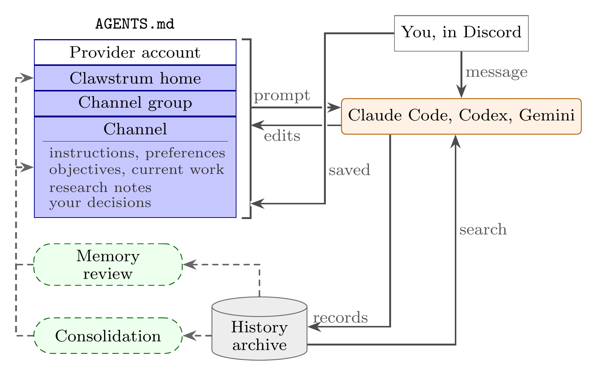

# Memory

Each channel has an `AGENTS.md` file with the agent's standing instructions for that channel and a `## MEMORY` section the agent keeps current. One more `AGENTS.md` in the Clawstrum home holds what all channels share. Every message and tool result is also kept in a searchable history, so memory only has to hold what is current.

<p align="center">
  
  <br><em>Blue: files the agent and the background passes (dashed) change.</em>
</p>

## Files

`H` is the Clawstrum home, `~/.clawstrum` unless `CLAWSTRUM_HOME` says otherwise.

```text
H/
  AGENTS.md                      shared by all channels
  clawstrum.db                   queues, schedules, sessions and the history
  history/records/
  channels/<discord-channel-id>/
    AGENTS.md                    this channel only
    history/records/
    artifacts/
```

A run loads the provider account's instructions, then `H/AGENTS.md`, then the `AGENTS.md` of each [channel group](groups.md) the channel is in, then the channel's own. Threads and DMs count as channels, and a thread loads its parent channel's file before its own. The `AGENTS.md` at the root of this repository is for agents working on Clawstrum's code and is not one of these files.

You can edit the files by hand. Clawstrum saves each version it has seen before it writes a new one.

## Memory sections

| Section                     | Holds                                                                            |
| --------------------------- | -------------------------------------------------------------------------------- |
| Working understanding       | Goals, findings, decisions in force, open questions                              |
| Current work                | Work in progress, next steps, artifacts, jobs already started                    |
| Research state              | Findings with their evidence, and a generated list of active jobs and subagents  |
| History access and coverage | Where the history is and how far consolidation has read it                       |
| Last compaction summary     | The latest compaction summary, until a pass merges it and leaves a one-line note |

A corrected decision replaces the old one. The old reasoning stays in history.

## Agent tools

- `memory_update` replaces one memory section. It fails if the file changed since the agent read it, and it can't change standing instructions.
- `research_note` saves a finding to history and to Research state. A note that replaces an older one links to it, and the older one is dropped from memory.
- `history` searches, lists or reads the history of the channel or the shared scope. Search covers whole records, including the middle of long ones.
- `memory_review` requests a memory review (below) or shows its state.

From the shell, `clawstrum history SESSION --action search --query TEXT` searches the same history, and `clawstrum export SESSION FILE` writes a channel's documents, history and research records to a file.

## History

Clawstrum records every message, tool result and memory revision the provider shows, first in `clawstrum.db`, then as one JSON file per record under `history/records/`. Missing files can be rebuilt from the database. On Claude, the native transcript is also archived at each compaction. History grows without limit, so back up both the database and the channel folders.

## Background passes

Three passes keep memory in step with the history. They run on your subscription, start only when the channel is idle and stop when a new message arrives. Finished chunks are kept.

- Memory review runs after a burst of activity, at most every five minutes. It fixes memory lines and standing instructions that the new history contradicts, and marks replaced notes.
- Daily consolidation runs once a day, at the first idle moment after 4:00 local time by default, for each channel with new history and once for the shared file. It rereads the new conversation, notes and claims (not raw tool output), writes what it learned as dated rules under `#### Reusable knowledge`, and keeps the rest of the memory section complete. It never deletes a line only to save space. For a channel with a large backlog it reads only the newest 8 chunks and records the skipped range, which stays in history.
- A compaction merge runs after Claude Code or Codex shortens its own context. Afterwards Clawstrum gives the agent its current instructions and memory again. On Claude, it archives the transcript first and puts the compaction summary into `### Last compaction summary`. At the next idle moment the merge folds it into the other sections, and the next turn starts a fresh session from `AGENTS.md`. Codex gives no summary text, so there the merge reads the new history instead.

Every proposal is checked before it is written: each change must cite a history record, open jobs and file paths in Current work can't disappear without a record that resolves them, and the file must still be at the revision the pass read. A rejected proposal gets two retries. After three rejected passes at the same point, passes pause for six hours, doubling up to 24.

A finished consolidation logs a `consolidation_completed` event and a deferred or failed one logs `consolidation_deferred`, so you can check that it runs.

## Call limits

- Memory reviews, compaction merges and group reviews share 24 model calls per rolling 24 hours, started at least 30 minutes apart.
- 6 of those 24 are kept for compaction merges, which go first and skip the 30-minute wait.
- The daily pass has its own 120 calls per 24 hours and no wait.
- All passes run one at a time.

`clawstrum maintenance status` shows what is used and when the next call can start. To stop all background passes, set `runtime.maintenance.maxCallsPerDay` and `runtime.consolidation.daily.maxCallsPerDay` to 0. History and compaction handling keep working.

## Configuration

```json
{
  "runtime": {
    "maintenance": {
      "maxCallsPerDay": 24,
      "minIntervalMs": 1800000,
      "maxConcurrent": 1,
      "requestedReserve": 6,
      "scanIntervalMs": 60000
    },
    "consolidation": {
      "enabled": true,
      "thresholdBytes": 0,
      "daily": {
        "enabled": true,
        "hour": 4,
        "maxCallsPerDay": 120,
        "tailChunks": 8
      },
      "chunkChars": 120000,
      "maxChunksPerPass": 8,
      "requestedTailChunks": 2,
      "timeoutMs": 600000,
      "models": { "claude": "sonnet" },
      "effort": "low"
    }
  }
}
```

On Claude, passes use `sonnet` at low effort. Other providers use the account's model. `runtime.consolidation.enabled: false` turns off consolidation, including the daily pass, and `runtime.consolidation.daily.enabled: false` turns off only the daily pass. `research.enabled: false` does not turn off memory. Old `research.consolidator.enabled`, `models` and `effort` values still apply unless `runtime.consolidation` sets them, so an old `enabled: false` there still turns consolidation off. The daily pass uses `daily.timezone` if set, else `runtime.timezone`, else the machine's time zone. A positive `thresholdBytes` also runs a consolidation, with a fresh session, whenever a channel has that many bytes of new history.

## Upgrading an older install

An install whose database is older than schema version 4 and has sessions needs a one-time offline migration. Clawstrum won't start until it is done:

1. Stop the daemon, its turns and subagents, and anything else that writes the database. Back up the database with SQLite's backup command (not `cp`), plus the configuration, the `AGENTS.md` files and the provider's session storage.
2. Run `clawstrum memory migrate --apply`. Add `--channels-root /absolute/path` to move the channel folders to a new root on the same filesystem. A failed run keeps its progress, so run it again after fixing the cause.
3. Check memory, channel IDs, schedules and paths, then start the daemon.

Old channel paths become symlinks, so jobs already submitted keep working. To roll back, restore the database, the documents and the folder layout together, with every writer stopped.
